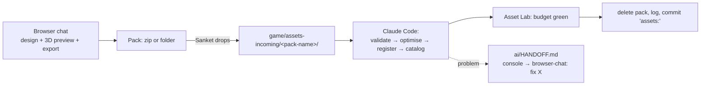

# Browser-chat Asset Handoff

> Decision **D-013**: characters and 3D assets are **designed in the claude.ai browser chat** (Swarajya project), not in Claude Code. The browser chat delivers ready **asset packs**; Claude Code only **integrates** them.
> **Claude Code must NOT redesign or re-model these assets.** If something is wrong, write it in `ai/HANDOFF.md` as `console → browser-chat: <what to fix>` and skip that asset.

## Flow


## Where packs go
`game/assets-incoming/<pack-name>/`, one folder per pack. Unzip a zip there first. The folder is **git-ignored**: raw packs are never committed.
Pack name: kebab-case, e.g. `mavala-v1`, `fort-kit-v1`, `props-village-v2`.

## Pack contents
| File | Required | Purpose |
|---|---|---|
| `*.glb` | yes (unless the pack is procedural-only) | Runtime models, glTF 2.0 binary. Humans use `standard-human-v1` bone names (`standard-rig.md`). |
| `*.ts` | optional | Procedural factory (code-built asset). Visual only, no gameplay logic; uses shared palette keys and standard bone names. |
| `assets.config.json` | yes | Colours and sizes (see below). |
| `catalog-entries.json` | yes | Entries to merge into `public/assets/catalog.json` (same schema as SETUP_PROMPT.md §3.2). |
| `preview.png` | yes | Preview image of the pack (≤ 1024 px); used to compare with what the Asset Lab shows. |
| `README.md` | yes | What is in the pack, version, intended use, known limitations, licences of anything third-party. |

### `assets.config.json` (shape)
```json
{
  "pack": "mavala-v1",
  "version": "1.0.0",
  "palette": { "cloth.saffron": "#E8781E", "cloth.red-sash": "#A8232B" },
  "assets": {
    "char.mavala.base": { "heightM": 1.72, "scale": 1.0, "notes": "origin at feet, faces +Z" }
  }
}
```
Palette keys must match (or be added to) the shared `materials.ts` palette; new keys are reported in the HISTORY entry.

### `catalog-entries.json` (shape)
```json
[
  {
    "id": "char.mavala.base",
    "class": "character",
    "source": "file",
    "file": "assets/shared/characters/mavala.glb",
    "rig": "standard-human-v1",
    "lods": [0, 1],
    "budgetTris": 3000,
    "respectTag": "ally",
    "tags": ["human", "soldier"],
    "variants": ["mavala.default", "mavala.red-sash", "mavala.elder"]
  }
]
```
For a procedural asset: `"source": "procedural:<factory>"` and `"file": null`. The `file` path is where the GLB will live **after** integration.

## Integration steps (Claude Code)
**a) Validate the pack**
- All required files present; JSON files parse and pass the zod schemas (catalog entry schema from Session 2; pack config schema alongside it).
- Every GLB loads; humans have the `standard-human-v1` bone names; units are metres, +Y up, facing +Z.
- Triangle and texture counts are within `docs/assets/budgets.md` (LOD0 and LOD1); every model > 500 tris has a LOD.
- Every catalog entry has a correct `respectTag`; revered figures follow `docs/game/respect-guidelines.md`.
- Third-party content is listed in the pack README with its licence.
- Any failure → don't fix it by re-modelling: log `console → browser-chat: …` in HANDOFF and skip that asset.

**b) Optimise GLBs**: `gltf-transform optimize` with meshopt geometry and KTX2 textures (WebP fallback), then move them to `game/public/assets/shared/<class>/` (`characters`, `props`, `buildings`, `nature`, `horses`).

**c) Factories**: put any `.ts` factory in `game/packages/shell/src/assets/<class>/` and register it in the procedural asset registry. Only make mechanical changes (imports, palette keys, lint/type fixes); never change the design.

**d) Catalog**: merge `catalog-entries.json` into `game/public/assets/catalog.json` (replace entries with the same id, keep the others). Run `tools/validate-catalogs`.

**e) Check in the Asset Lab**: every asset opens in 360°, the budget is green, clips play, it matches `preview.png`. Then delete the processed pack folder from `game/assets-incoming/`.

**f) Log and commit**: add an `ai/HISTORY.md` entry (pack name and version, assets added, budgets, issues sent back) and commit with the `assets:` prefix, e.g. `assets: import pack mavala-v1`. Licences go into `docs/assets/LICENSES.md`.

## Feedback to the browser chat
Format in `ai/HANDOFF.md` → Open:
```
- [ ] 2026-11-18 console → browser-chat: mavala-v1 / char.mavala.base LOD0 is 3,840 tris (budget 3k); please reduce (refs: docs/assets/budgets.md)
```
Sanket carries these to the browser chat; the fixed pack comes back with a bumped version.
