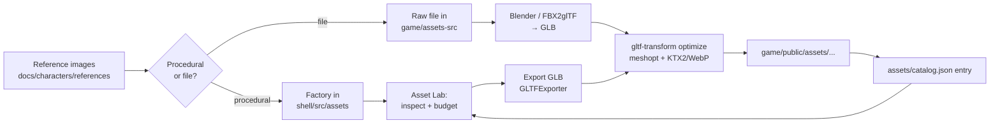

# Asset Pipeline

## Steps
1. **Source.** Reference images (`docs/characters/references/<id>/`) or a third-party CC0 model (record it in `LICENSES.md`). Raw files go in `game/assets-src/` (git-ignored except small files).
2. **Build or convert.**
   - Procedural: a factory using standard-rig bones (humans) and shared palette keys. Visual only, no gameplay logic.
   - File: convert to GLB with Blender or FBX2glTF. Rename bones to `standard-human-v1` names for humans.
3. **Optimise.** `gltf-transform optimize` with meshopt geometry and KTX2 (or WebP) textures; resize textures to budget.
4. **LOD.** Every model > 500 triangles needs LOD1 (generated with `meshoptimizer` simplify or authored).
5. **Catalog.** Add an entry to `game/public/assets/catalog.json` (see SETUP_PROMPT.md §3.2 for the schema). Validated with zod at runtime and by `tools/validate-catalogs`.
6. **Inspect.** Open the Asset Lab: triangle/texture budget must be green, respect tag correct, clips play.
7. **Commit** the compressed output (never raw files > 20 MB): `assets: add <id>`.

Tools and versions: `docs/tech/tools.md`. Budgets: `budgets.md`.
