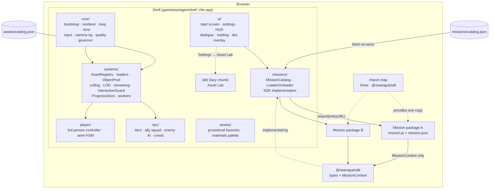
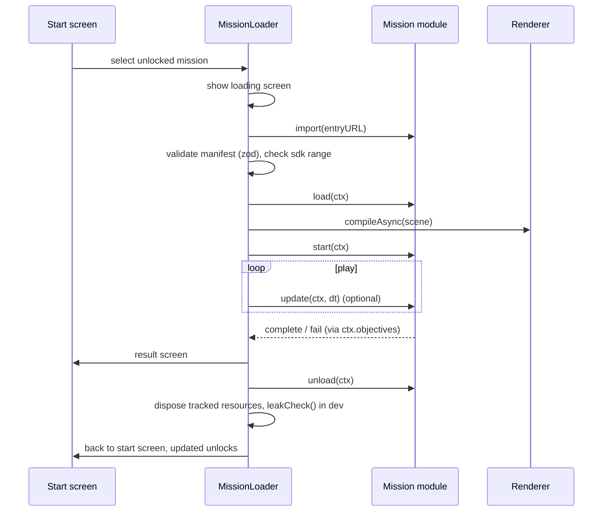

# Architecture

## Big picture

## Rules (from `ai/RULES.md` §1.2)
- The Shell owns the engine, systems, UI, player, NPC pool and asset system.
- Missions talk to the Shell **only** through `@swarajya/sdk` (`MissionContext`). They never import Shell internals or each other.
- Missions are data + code packages discovered at runtime from `catalog.json`. Adding a mission = build the package + add a catalog entry. No Shell rebuild.
- `three` and `@swarajya/sdk` are externals in mission builds and come from the Shell's import map in production.
- Progress goes through the `ProgressStore` interface (`MemoryProgressStore` now).
- All player actions on entities go through `InteractionGuard` (respect tags).
- Asset factories are visual only; animations target standard bone names.
- TypeScript strict; manifests validated with `zod`; invalid missions/assets are skipped with a clear error.

## Mission lifecycle

## Frame (target design; built in Session 1)
1. Input sample → 2. fixed-step update (60 Hz, max-delta clamp) → 3. NPC tier scheduling → 4. time-sliced tasks (≤ 4 ms) → 5. culling/LOD → 6. render → 7. overlay stats (dev) → 8. quality governor.

## Current state (Session 0)
Only `core/` (renderer + loop for an empty scene) and `ui/devOverlay` exist. The SDK package contains type stubs only.
